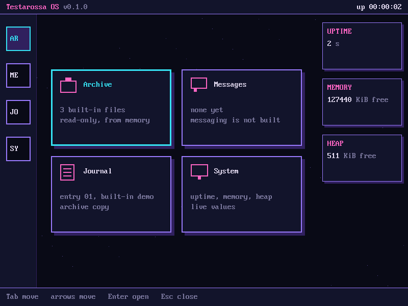
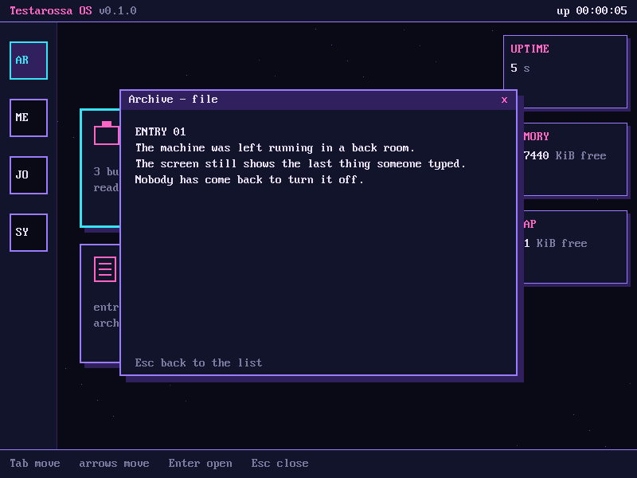
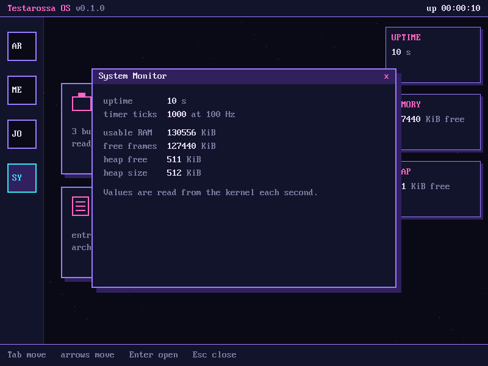
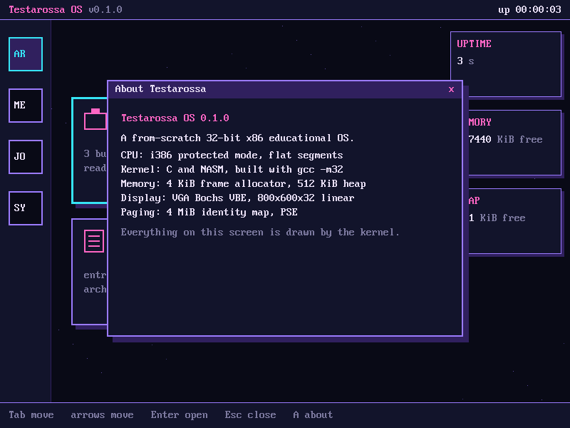
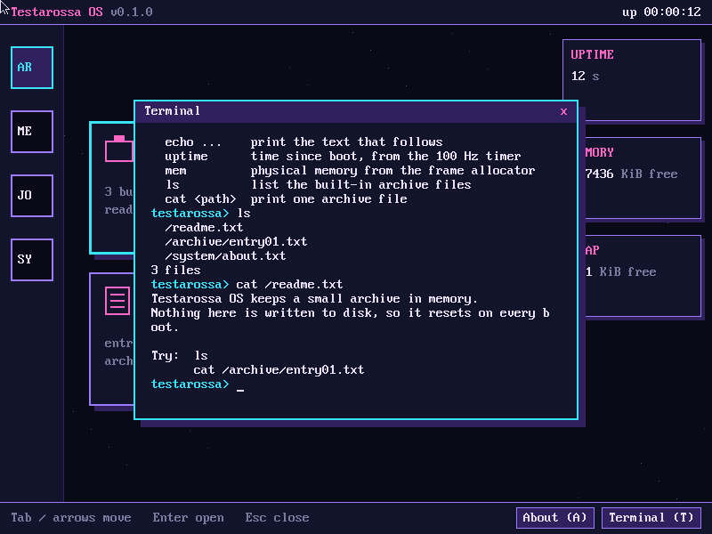
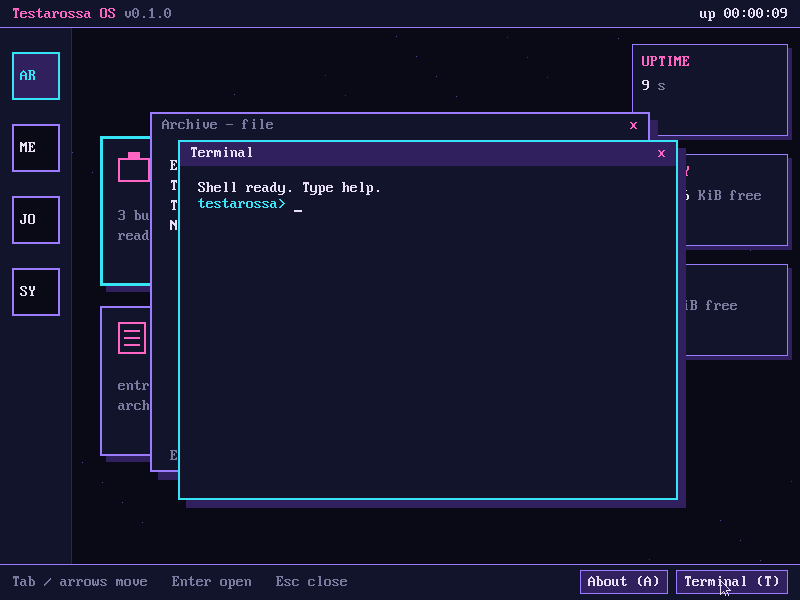
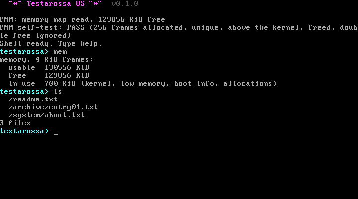
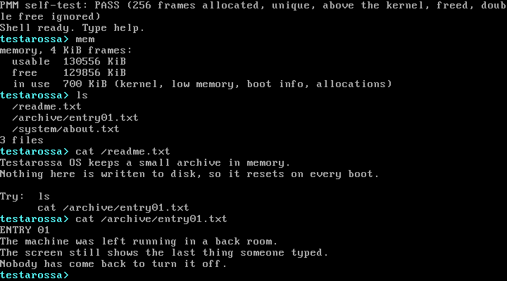
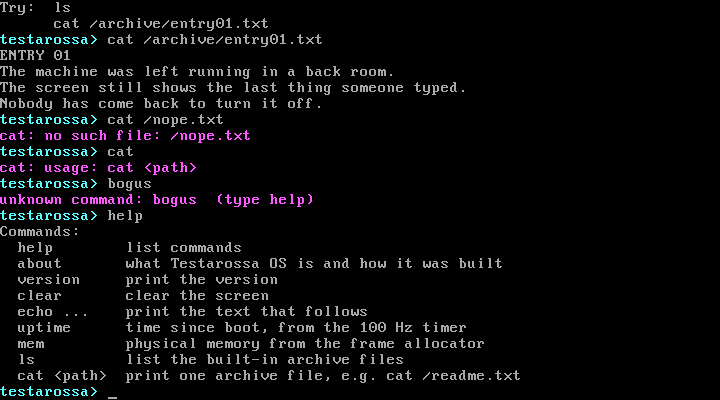
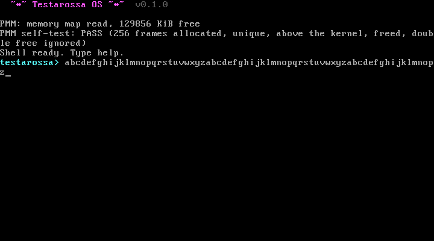

# Testarossa OS

A from-scratch **32-bit x86 educational operating system** written in
freestanding C and NASM. It boots in QEMU, handles interrupts, reads the
keyboard, manages memory with paging and a heap, serves a built-in read-only
archive, and runs a **cyber-gothic desktop** on an 800x600 framebuffer.
A text shell is available too.



> **Status:** the kernel boots, handles interrupts, reads the keyboard,
> counts timer ticks, manages physical memory, paging, and a heap, draws a
> graphical desktop with up to four windows at once (including a Terminal
> that runs the shell), works with a PS/2 mouse, and runs a text shell.
> Window dragging, a scheduler, and user mode are not built.
> See [Status](#status) for the full list.

> **For classmates:** start with [to-test.txt](to-test.txt). It lists what to
> test first and includes debug challenges with known problems.

---

## Contents

- [What it is](#what-it-is)
- [Status](#status)
- [Quick start](#quick-start)
- [Using the desktop](#using-the-desktop)
- [Using the text shell](#using-the-text-shell)
- [Testing](#testing)
- [How it works](#how-it-works)
- [Source layout](#source-layout)
- [Build details](#build-details)
- [Design and documentation](#design-and-documentation)
- [Contributing](#contributing)
- [Limitations](#limitations)
- [Roadmap](#roadmap)

---

## What it is

Testarossa OS is a teaching operating system. It is small enough to read in
an afternoon, and each part does one thing that you can explain:

- **Boot**: a Multiboot header, an assembly entry point that sets up a stack,
  then hands off to C.
- **CPU tables**: a Global Descriptor Table (GDT) and an Interrupt Descriptor
  Table (IDT).
- **Interrupts**: 32 CPU exception handlers and 16 hardware IRQ handlers.
  Exceptions print a diagnostic and halt. Page faults also print the faulting address.
- **Devices**: a legacy 8259 PIC, the 8253/8254 timer, a PS/2 keyboard, VGA
  text, a Bochs VBE linear framebuffer, and serial output on COM1.
- **Memory**: a physical frame allocator, paging (a 4 MiB identity map and
  4 KiB mappings), and a kernel heap.
- **Graphics**: pixel and rectangle drawing, lines, and an 8x16 font, drawn on
  a back buffer and copied to the screen in one pass.
- **Desktop and shell**: a graphical desktop with four panels, and a
  line-editing text shell.

It runs on **32-bit x86 (i386)** in **protected mode**, inside **QEMU**.
It does not use libc. It has no dependency on an existing operating system
at run time.

### Why this project looks the way it does

The project follows a four-week plan built around one rule: a kernel that
works and can be explained is worth more than a long list of unfinished
features. Every feature is either working and tested, or labelled
"not implemented yet" on screen. Nothing is faked.

---

## Status

| Area | Feature | Status |
|---|---|---|
| Boot | Multiboot entry, stack, handoff to C | Done |
| Output | VGA text 80x25 with hardware cursor and colours | Done |
| Output | Serial COM1 (38400 8N1) | Done |
| CPU | GDT with flat kernel code and data | Done |
| Interrupts | IDT with exception and IRQ stubs | Done |
| Interrupts | Exception diagnostics (vector, error code, EIP) | Done, tested with a divide-by-zero |
| Interrupts | Page-fault report (address, present, read/write, mode) | Done, tested |
| Devices | 8259 PIC remap, only IRQ0, IRQ1, IRQ2 (cascade), and IRQ12 unmasked | Done |
| Devices | PIT timer at 100 Hz | Done |
| Input | PS/2 keyboard via IRQ1: Shift, Backspace, arrow keys | Done |
| Memory | Physical frame allocator (bitmap, 4 KiB, from the Multiboot map) | Done, self-tested at boot |
| Memory | Paging: 4 MiB identity map, 4 KiB map and unmap | Done, self-tested at boot |
| Memory | Kernel heap: first-fit, split and merge, 512 KiB | Done, self-tested at boot |
| Files | RAM filesystem with three built-in read-only files | Done |
| Graphics | Framebuffer, 800x600x32, via Bochs VBE on QEMU `-vga std` | Done |
| Graphics | Drawing: pixels, rectangles, frames, lines, 8x16 text | Done |
| Desktop | Top bar, rail, hub tiles, status cards, dock | Done |
| Desktop | Panels: About, System Monitor, Archive (list and file), Journal, Messages (placeholder), Terminal | Done |
| Desktop | Keyboard: Tab, arrows, Enter, Esc, A, T | Done |
| Desktop | Up to four windows at once, stacked; Tab cycles them, click raises | Done |
| Desktop | Terminal window that runs the shell | Done |
| Input | PS/2 mouse via IRQ12: pointer, click tiles, rows, close box, dock buttons | Done, tested with QEMU's PS/2 mouse |
| Shell | `help`, `about`, `version`, `clear`, `echo`, `uptime`, `mem`, `ls`, `cat` | Done (text mode and Terminal window) |
| Desktop | Dragging windows | Not built (stretch) |
| Input | Backspace across a wrapped line | **Known bug**, left for classmates to debug (to-test.txt D1) |
| Scheduler | Processes, context switch, user mode | Not planned for this exam |

Every "Done" item has a verification record in [VERIFY.md](VERIFY.md).

---

## Quick start

These steps are for **Windows 10/11 with WSL2 and Ubuntu**. Everything
builds inside Ubuntu. Windows is only used to run the project files and
the QEMU window.

### 1. Install the tools (once)

Open the Ubuntu terminal:

```sh
sudo apt update
sudo apt install -y nasm qemu-system-x86 make gcc
```

Check they are installed. Each command should print a path:

```sh
which nasm qemu-system-i386 make gcc
```

### 2. Get the code

```sh
git clone https://github.com/JerenzeLevi/testarossa-os.git
cd testarossa-os
```

If you downloaded a ZIP, go to its folder instead. Windows drives appear
under `/mnt`, for example `cd /mnt/c/Users/you/Downloads/testarossa-os`.

### 3. Build

```sh
make clean
make
```

Output: `build/testarossa.elf`.

### 4. Run the desktop

```sh
make run
```

A QEMU window opens with the desktop. Serial output appears in your terminal:

```
Testarossa OS v0.1.0 booting...
GDT loaded
IDT loaded
PIC remapped to vectors 32-47; IRQ0 (timer), IRQ1 (keyboard), IRQ12 (mouse) unmasked
mouse: PS/2 mouse on, IRQ12
PIT programmed to 100 Hz
PMM: memory map read, 127448 KiB free
PMM self-test: PASS (256 frames allocated, unique, above the kernel, freed, double free ignored)
Paging on: first 1 GiB identity-mapped with 4 MiB pages
paging self-test: PASS (identity map on, 4 KiB map, write, unmap)
heap self-test: PASS (64 blocks, no overlap, holes reused, arena merged back)
framebuffer: PCI slot 2, memory at 0xFD000000, 800x600x32, pitch 3200
```

Click the QEMU window to give it keyboard focus. Close the window to stop.

### 5. Run the text shell instead

```sh
make clean
make run-text
```

This builds without graphics, so the text shell starts. Go back to the desktop
with `make clean && make`.

---

## Using the desktop

Click the QEMU window first so it has keyboard focus. QEMU then also captures
the mouse; press Ctrl+Alt+G to release it.

| Key | What it does |
|---|---|
| Tab | No window open: move focus to the next hub tile (Archive, Messages, Journal, System, then Archive again). Windows open: bring the bottom window to the top. |
| Arrow keys | Move focus in the 2x2 hub grid. Stops at the edges. |
| Enter | Open the focused tile. In the Archive list, opens the selected file. |
| Up / Down | In the Archive list, choose a file. |
| Esc | In a file, go back to the list. Otherwise close the top window. |
| A | Open About (it has no tile). Not while the Terminal is on top, where it is typed. |
| T | Open the Terminal. Not while the Terminal is on top, where it is typed. |

| Mouse | What it does |
|---|---|
| Click a hub tile or rail square | Open it. |
| Click a window under the top one | Bring it to the top. |
| Click `x` on the top window | Close it. |
| Click an Archive row | Select it. Click it again to open the file. |
| Click About or Terminal in the dock | Open that window. Works with windows open. |

The focused tile has a bright cyan outline. The rail square next to it lights too.

### Windows

Up to four windows can be open. Each one is drawn a little lower and to the
right of the one beneath it. The top window has the cyan border and gets the
keys. Opening a window that is already open brings it to the top. Opening a
fifth window closes the bottom one.

### Terminal

The Terminal window runs the same shell as `make run-text`, with the same
commands and colours. Shell output goes to serial, to the text screen, and to
the window's 56 x 18 grid, which wraps long lines and scrolls. The shell starts
the first time the Terminal opens and keeps its screen when you close and
reopen it.

### The hub

| Tile | Opens | Content |
|---|---|---|
| Archive | File list | The three built-in files. Enter opens one. |
| Messages | Placeholder | "No messages." Messaging is not built, and the panel says so. |
| Journal | Journal | A built-in demo entry, copied from the archive. |
| System | System Monitor | Uptime, timer ticks, usable RAM, free frames, heap free and size. Refreshes each second. |

The right side shows three cards, UPTIME, MEMORY, and HEAP. The top bar shows
live uptime. The dock at the bottom shows the key hints and the About and
Terminal buttons.

### Built-in archive

| Path | Contents |
|---|---|
| `/readme.txt` | How the archive works and what to try. |
| `/archive/entry01.txt` | A short, original journal entry. |
| `/system/about.txt` | Name, version, and what the file is. |

The archive lives in memory and resets on every boot. Nothing is written to disk.

### Desktop screenshots

| Home | Archive file | System Monitor | About |
|---|---|---|---|
|  |  |  |  |

| Terminal | Two windows |
|---|---|
|  |  |

---

## Using the text shell

Start it with `make run-text`. Type a command and press **Enter**. Backspace
erases the last character you typed (it will not erase the prompt). Lines are
limited to **127 characters**. The keyboard layout is **US**.

| Command | What it does |
|---|---|
| `help` | List the commands. |
| `about` | Name, version, and a short description of the system. |
| `version` | Print `Testarossa OS 0.1.0`. |
| `clear` | Clear the screen. |
| `echo <text>` | Print the text after `echo`. |
| `uptime` | Seconds since boot and the tick count, e.g. `up 13 s (1302 ticks at 100 Hz)`. |
| `mem` | Usable, free, and in-use memory in KiB, and the heap free amount. |
| `ls` | List the built-in archive files. |
| `cat <path>` | Print one archive file, e.g. `cat /readme.txt`. |

Anything else prints `unknown command: <word>  (type help)`.

Colours: the prompt word is cyan, errors are magenta, body text is grey.

### Text shell screenshots

| Memory and listing | Reading files | Errors and help |
|---|---|---|
|  |  |  |

Known bug, shown on purpose (see to-test.txt, challenge D1):



---

## Testing

- **Classmates**: follow [to-test.txt](to-test.txt). It has 29 numbered tests
  with exact expected output, seven debug challenges, and a template for
  reporting results.
- **Maintainers**: [VERIFY.md](VERIFY.md) records every milestone, the commands
  used, and what happened. New entries go at the bottom of the log.

### Quick checks

```sh
make clean && make                          # clean build must succeed
make run                                    # desktop appears; boot log shows PASS for PMM, paging, heap
make clean && make fault-test && make run   # must print "!! EXCEPTION divide error"
make clean && make pf-test && make run      # must print "!! EXCEPTION page fault ... address=0x80000000"
make clean && make run-text                 # text shell starts
make clean && make                          # restore the normal kernel afterwards
```

The two crash builds are for checking the exception paths only.

### Automated checks for a maintainer

`tools/run_tests.py` builds the kernel, boots it in QEMU, drives it through the
monitor socket, and checks the result against what this README documents. It
covers the boot log, the boot-time self-tests, the framebuffer mode line, the
shell commands, and the two crash builds.

```sh
python3 tools/run_tests.py                 # everything
python3 tools/run_tests.py --boot-only     # boot log and self-tests only
python3 tools/run_tests.py --shell-only    # shell commands only
python3 tools/run_tests.py --with-crash    # also fault-test and pf-test
python3 tools/run_tests.py --shots         # PNG screenshots into build/shots/
python3 tools/run_tests.py --list          # show the checks, run nothing
```

It needs the same tools as the build plus Python 3.8 or newer, and no
third-party Python packages. It exits non-zero if any check fails, so it can be
used as a pre-commit gate.

It reads the serial log, so it judges what the kernel actually printed. It does
**not** cover mouse edge cases or long-run stability, because a person judges
those better than a script. Those still need to-test.txt.

The harness was contributed alongside the issue templates and is recorded in
VERIFY.md, including which parts have been run and which have not.

---

## How it works

### Boot path

```
GRUB or QEMU -kernel
  -> Multiboot header        boot/multiboot.asm   (magic, flags, checksum)
  -> _start                  boot/multiboot.asm   (set stack, push magic and info, call)
  -> kernel_main(magic,info) kernel/kernel.c
       vga_init, serial_init
       check magic == 0x2BADB002
       gdt_init        -> load GDT, reload segment registers
       idt_init        -> install 48 gates, load IDT
       pic_init        -> remap IRQs to 32-47, unmask IRQ0, IRQ1, IRQ2, IRQ12
       mouse_init      -> turn on the 8042 aux port and mouse reporting
       timer_init      -> PIT at 100 Hz
       pmm_init        -> read the Multiboot memory map, reserve used ranges
       pmm_selftest    -> allocate, check, and free 256 frames
       paging_init     -> identity-map 1 GiB with 4 MiB pages, turn on paging
       paging_selftest -> map, write, unmap one 4 KiB page
       heap_init       -> one free block over the 512 KiB arena
       heap_selftest   -> 64 blocks, holes reused, merged back
       fb_init         -> find the VGA card, set 800x600x32, map the framebuffer
         ok   -> desktop_run   (never returns)
         fail -> shell_run     (text shell)
```

### One interrupt path, end to end: a key press

This is the path that the exam asks students to explain.

1. You press a key. The keyboard controller (8042) reads the scancode, which
   is set 1 by default, and raises **IRQ1** on the PIC.
2. The PIC sends vector **33** (IRQ1 remapped to 32 + 1) to the CPU.
3. The CPU looks up **IDT entry 33**. The gate points at `isr33`, an interrupt
   gate, so the CPU clears IF and switches to ring 0.
4. `isr33` pushes a fake error code and the vector number, then jumps to
   `isr_common`.
5. `isr_common` pushes all general registers and the segment registers, loads
   the kernel data segment, and calls `isr_dispatch(regs_t *)` in C.
6. `isr_dispatch` sees vector 33, so IRQ 1. It calls `keyboard_irq_handler`.
7. The handler reads **port 0x60** once, which gives the scancode. It turns
   the scancode into a key code (with Shift, and with the `0xE0` prefix for
   arrows) and pushes it into a 64-byte ring buffer. It returns.
8. `isr_dispatch` calls `pic_send_eoi(1)`. The PIC can now deliver the next IRQ.
9. `isr_common` restores the registers and runs `iret`. The CPU restores IF
   and returns to the main loop.
10. The desktop or shell takes the key from the buffer on its next pass.

Design rule: the handler only does the minimum (read, store, acknowledge).
All drawing and command logic run outside the interrupt.

### Exceptions

Vectors 0-31 are CPU exceptions. For example, dividing by zero raises
vector 0 (`#DE`). The handler prints the exception name, the vector, the error
code (when the CPU pushes one), and the instruction pointer, then halts.

Page faults (vector 14) also print CR2, the address that faulted, and the
error bits: whether the page was present, whether it was a read or write,
and whether it was user or kernel mode. You can test it with `make pf-test`.

### Physical memory

The bootloader gives a memory map: a list of regions, each marked usable or
reserved. `pmm_init` walks that list and sets one bit per 4 KiB frame in a
bitmap. Usable frames start as free. Then it reserves:

- low memory below 1 MiB (BIOS, VGA, legacy areas),
- the kernel image, from 1 MiB up to `_kernel_end` (set by `linker.ld`),
- the boot info and the map buffer itself.

`pmm_alloc_frame` finds a free bit, sets it, and returns the frame address.
`pmm_free_frame` clears the bit again. Freeing a frame that is already free,
or one in low memory, does nothing.

### Paging

`paging_init` builds one page directory. The first 1 GiB is identity-mapped
with 4 MiB pages (the PSE feature), so virtual address equals physical address
there. The directory and any page tables come from the frame allocator. Paging
is turned on only after the tables are built.

For addresses outside that range, `paging_map` makes a 4 KiB mapping and
allocates a page table if needed. The self-test maps `0x80000000`, writes
through the mapping, checks the physical frame, and unmaps it.

### Kernel heap

The heap is a first-fit allocator over a fixed 512 KiB arena in `.bss`. Each
block has a 16-byte header with its size, a free flag, and a pointer to the next
block. `kmalloc` takes the first free block that fits, splits it when the rest
is large enough, and returns the payload. `kfree` marks a block free and
merges every run of adjacent free blocks.

Design note: the plan suggested building the heap on separate PMM frames. A
fixed arena keeps the blocks contiguous and the code short. It is documented
in [docs/FUNCTIONS.md](docs/FUNCTIONS.md).

### Framebuffer

QEMU's loader does not support the Multiboot video request, so the framebuffer
is set through the Bochs VBE registers on QEMU's standard VGA card. `fb_init`:

1. finds the card on PCI (vendor `0x1234`, device `0x1111`),
2. reads its BAR0 for the framebuffer address,
3. checks the VBE interface answers with a known ID,
4. sets 800x600x32, and reads back width, height, bits per pixel, and enable,
5. maps the framebuffer memory into the page tables.

If any step fails, the kernel logs the reason and starts the text shell. No
address is guessed. Drawing goes to a back buffer, which is copied to the
screen in one pass, so the screen does not flicker.

### Desktop

`desktop_run` is the main loop. It reads a key when one is waiting and the
mouse position and buttons. It redraws after each key, each mouse change, and
once per second, so the uptime and the monitor values stay current. When
nothing has changed it sleeps with `sti; hlt`.

Open windows are kept in a small stack (`stack[0]` is the bottom). Drawing goes
bottom to top; clicks are checked top to bottom. The mouse driver collects the
3-byte PS/2 packets on IRQ12 and keeps a clamped pointer position. A click is
the moment the left button goes from up to down.

The Terminal window uses `log_set_sink`: every character the shell prints
through `log_putc` is also stored in the terminal grid (`terminal.c`), with the
current text colour mapped to the graphics palette (`palette.c`).

Everything drawn is either a fixed layout, a fixed colour from the design
document, or a value read from the kernel. The Messages and Journal panels say
clearly which content is built in.

### Built-in archive

`ramfs` is a table of three files compiled into the kernel. `ls` walks the
table and `cat` looks up a path with an exact string match. No disk is used.

---

## Source layout

```
Testarossa_OS_Master_Plan.txt   project plan (scope and weeks)
README.md                       this file
to-test.txt                     test guide for classmates
VERIFY.md                       verification log, append only
THIRD-PARTY-NOTICES.md          licence notice for the 8x16 font
Makefile                        build, run, run-text, fault-test, pf-test, clean
linker.ld                       places the kernel at 1 MiB, Multiboot first

boot/
  multiboot.asm      Multiboot header, stack, _start, handoff to kernel_main

kernel/
  kernel.c           kernel_main: init order, then desktop or shell
  version.h          name and version strings (single source)
  io.h               port I/O: outb/inb, outw/inw, outl/inl, io_wait
  vga.c/.h           VGA text output, colours, scroll, hardware cursor
  serial.c/.h        COM1 serial output
  log.c/.h           print to VGA, serial, and an optional sink (log_putc, log_puts, log_dec, log_hex)
  cpu.asm            lgdt/lidt loaders and the GDT segment reload
  gdt.c/.h           flat code and data descriptors
  interrupts.asm     48 interrupt stubs and the common register save/restore
  idt.c/.h           IDT setup and isr_dispatch (exceptions, page faults, IRQ routing)
  pic.c/.h           8259 PIC remap, mask, EOI
  timer.c/.h         PIT at 100 Hz and tick counter
  keyboard.c/.h      IRQ1 handler, scancode table, arrow keys, key queue
  mouse.c/.h         PS/2 mouse setup and IRQ12 packet handler
  pmm.c/.h           physical frame allocator and its boot-time self-test
  paging.c/.h        identity map, 4 KiB map/unmap, self-test
  heap.c/.h          kernel heap (first fit, merge) and its self-test
  framebuffer.c/.h   PCI probe, Bochs VBE mode set, framebuffer mapping, present
  draw.c/.h          pixels, rectangles, frames, lines, text on the back buffer
  font.h             font interface
  font8x16.c         8x16 font data, generated by tools/make_font.py
  palette.c/.h       graphics colours, and text colour -> graphics colour
  desktop.c/.h       the desktop: scene, window stack, keyboard and mouse handling
  terminal.c/.h      text grid for the Terminal window (a log sink)
  ramfs.c/.h         built-in read-only archive (three files)
  shell.c/.h         text shell: line editor and commands

tools/
  make_font.py       turns a PSF console font into kernel/font8x16.c
  run_tests.py       automated checks: boots QEMU and verifies boot log, self-tests, shell

.github/
  ISSUE_TEMPLATE/    bug report and test report forms

docs/
  DESIGN.md          UI, UX, and GUI design (locked, change via issue)
  FUNCTIONS.md       every function: done, planned, and its signature
  screenshots/       screen captures used in this README and VERIFY.md
```

---

## Build details

| Item | Value |
|---|---|
| Target | i386, 32-bit protected mode |
| Compiler | `gcc -m32 -std=gnu99 -ffreestanding -O2 -fno-stack-protector -fno-pic -fno-builtin -nostdlib` |
| Assembler | `nasm -f elf32` |
| Linker | `ld -m elf_i386 -T linker.ld -nostdlib` |
| Load address | 1 MiB |
| Output | `build/testarossa.elf` (Multiboot ELF) |
| Emulator | `qemu-system-i386 -kernel build/testarossa.elf -serial stdio -vga std` |

Make targets:

| Target | Does |
|---|---|
| `make` / `make all` | Build `build/testarossa.elf` |
| `make run` | Build if needed, then boot the desktop in QEMU with serial on the terminal |
| `make run-text` | Clean build without graphics, then boot the text shell. Run `make clean && make` afterwards. |
| `make fault-test` | Build a kernel that divides by zero. Run `make clean && make` after. |
| `make pf-test` | Build a kernel that reads an unmapped address. Run `make clean && make` after. |
| `make clean` | Delete `build/` |

Known build output: the linker prints a warning that the single load segment
is RWX. It is harmless for this exam and is listed under Limitations.

To regenerate the font: `python3 tools/make_font.py <Lat15-VGA16.psf> kernel/font8x16.c`.
The source font is in the `console-setup-linux` package (`/usr/share/consolefonts/`).

---

## Design and documentation

| Document | What it covers |
|---|---|
| [docs/DESIGN.md](docs/DESIGN.md) | Colours, layouts, keyboard rules, and the design lock. Change it through an issue first. |
| [docs/FUNCTIONS.md](docs/FUNCTIONS.md) | Each function: purpose, inputs, status. Planned functions included. |
| [VERIFY.md](VERIFY.md) | What was tested, how, and the result. |
| [to-test.txt](to-test.txt) | Step-by-step tests and debug challenges for classmates. |
| [CONTRIBUTING.md](CONTRIBUTING.md) | The short version of the rules below. |
| [Testarossa_OS_Master_Plan.txt](Testarossa_OS_Master_Plan.txt) | Scope, four-week schedule, and priorities. |

The visual identity is **Testarossa**: midnight navy, violet, electric cyan,
and hot magenta. It is an original design. It takes its mood from early-2000s
internet culture and archive exploration, and copies no existing product.

---

## Contributing

This is a class project, so the rules are short:

1. **Read [docs/DESIGN.md](docs/DESIGN.md) and [docs/FUNCTIONS.md](docs/FUNCTIONS.md)** before you change anything visible or add a function.
2. **Pick an issue or open one.** Use the labels: `kernel`, `shell`, `gui`,
   `ux-design`, `docs`, `testing`, and the week and priority labels.
3. **Make one change at a time.** Build it, boot it in QEMU, then commit.
4. **Update the docs in the same commit.** That means `FUNCTIONS.md` for
   functions, `VERIFY.md` for test results, `to-test.txt` if a test changes,
   and the Status table in this README.
5. **Never claim a feature works until it has been run.** Record the result in
   VERIFY.md.
6. **Do not change the design** (colours, names, layout, wording of user-facing
   text) without an approved `ux-design` issue.
7. **Keep the build warning-free** apart from the known RWX warning.

Branch names: `feature/<short-name>`, for example `feature/mouse`.

Commit messages: one short summary line, then a short body that says what
changed and how you tested it.

---

## Limitations

- **Keyboard**: US layout only. Caps Lock and Ctrl/Alt combinations are not
  handled. Only tested through the QEMU monitor, not on real hardware.
- **Known bug**: in the text shell, Backspace at the start of a wrapped row does
  not move back to the previous row, so the screen and the input line can
  disagree. Reproduced and documented in VERIFY.md (Entry 10). Left for
  classmates to find and fix (to-test.txt D1).
- **Text shell**: no history, no cursor movement with arrow keys, no tab completion.
  Input is capped at 127 characters. The Terminal window has the same Backspace
  bug at its wrap point.
- **Desktop**: windows cannot be dragged; their positions follow their place in
  the stack. At most four windows. Panels other than the Terminal do not wrap
  long lines (to-test.txt D2). Messages is a placeholder.
- **Mouse**: PS/2 only, three-byte packets (no scroll wheel), tested only with
  QEMU's emulated mouse. No pointer acceleration.
- **Graphics**: only on QEMU with `-vga std` (Bochs VBE). No support for real
  graphics hardware. The mode is fixed at 800x600x32.
- **Memory**: the allocator and paging have been tested in QEMU only. The
  allocator has not been tested on a machine without a memory map. The heap is
  a fixed 512 KiB arena, so `kmalloc` returns NULL when it is full, and this
  case is not tested yet.
- **Paging**: no page-fault recovery. The handler reports and halts.
- **Timer**: 100 Hz. The 32-bit tick counter wraps after about 497 days.
- **Exceptions**: only divide-by-zero and page fault have been tested. Other
  exceptions use the same handler, but they are not yet verified.
- **Files**: read-only and built in. No disk, no writing, no directories you can create.
- **Protection**: everything runs in ring 0. No user mode, no process isolation.
- **Linker**: the single load segment is RWX, which the linker warns about.
- **Hardware**: tested only in QEMU, not on physical machines.

---

## Roadmap

| Week | Focus | Status |
|---|---|---|
| 1 | Boot, output, keyboard | Done |
| 2 | Timer, frame allocator, paging, heap | Done |
| 3 | Shell and framebuffer foundation | Done (shell, framebuffer, drawing, font) |
| 4 | Desktop panels, RAM filesystem, stability, docs | Desktop, filesystem, Terminal window, several windows, and mouse done. Long stability runs still to do. |

The full plan, including the design bible and the exam demo, is in
[Testarossa_OS_Master_Plan.txt](Testarossa_OS_Master_Plan.txt).
