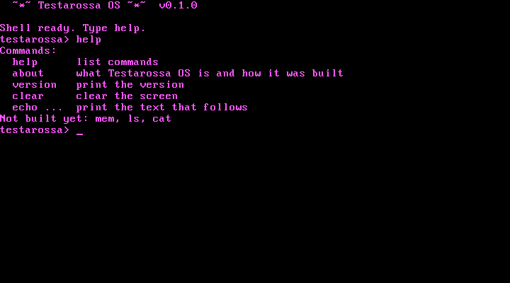
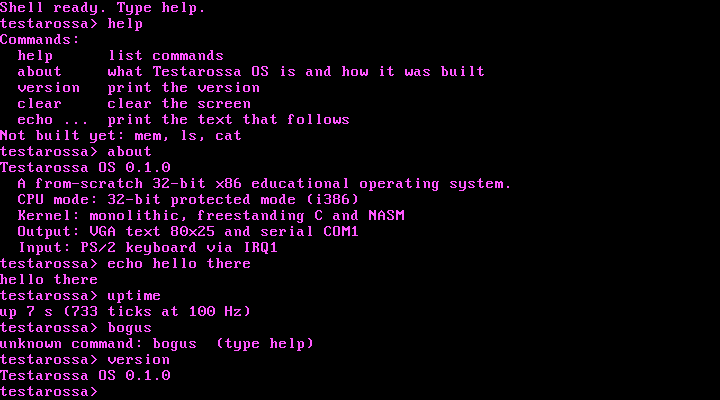
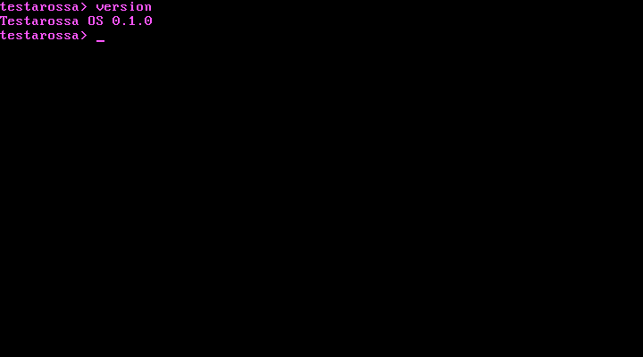

# Testarossa OS

A from-scratch **32-bit x86 educational operating system** written in
freestanding C and NASM. It boots in QEMU, prints to the screen and serial
port, handles interrupts, reads the keyboard, runs a small shell, and will
grow into a cyber-gothic desktop.



> **Status:** early development. The kernel boots, handles interrupts,
> reads the keyboard, counts timer ticks, and runs a working shell.
> Memory management, files, and the graphical desktop are planned and not yet built.
> See [Status](#status) for the full list.

---

## Contents

- [What it is](#what-it-is)
- [Status](#status)
- [Quick start](#quick-start)
- [Using the shell](#using-the-shell)
- [Testing](#testing)
- [How it works](#how-it-works)
- [Source layout](#source-layout)
- [Build details](#build-details)
- [Design and documentation](#design-and-documentation)
- [Contributing](#contributing)
- [Limitations](#limitations)
- [Roadmap](#roadmap)

---

## What it is

Testarossa OS is a teaching operating system. It is small enough to read in
an afternoon, and each part does one thing that you can explain:

- **Boot**: GRUB-compatible Multiboot header, an assembly entry point that
  sets up a stack, then hands off to C.
- **CPU tables**: a Global Descriptor Table (GDT) and an Interrupt Descriptor
  Table (IDT).
- **Interrupts**: 32 CPU exception handlers and 16 hardware IRQ handlers.
  Exceptions print a diagnostic and halt.
- **Devices**: a legacy 8259 PIC, the 8253/8254 programmable timer, a PS/2
  keyboard, VGA text output, and serial output on COM1.
- **Shell**: a line-editing command prompt with a handful of commands.

It runs on **32-bit x86 (i386)** in **protected mode**, inside **QEMU**.
It does not use libc. It has no dependency on an existing operating system
at run time.

### Why this project looks the way it does

The project follows a four-week plan built around one rule: a kernel that
works and can be explained is worth more than a long list of unfinished
features. Every feature is either working and tested, or labelled
"not implemented yet" on screen. Nothing is faked.

---

## Status

| Area | Feature | Status |
|---|---|---|
| Boot | Multiboot entry, stack, handoff to C | Done |
| Output | VGA text 80x25 with hardware cursor | Done |
| Output | Serial COM1 (38400 8N1) | Done |
| CPU | GDT with flat kernel code and data | Done |
| Interrupts | IDT with exception and IRQ stubs | Done |
| Interrupts | Exception diagnostics (vector, error code, EIP) | Done, tested with a deliberate divide-by-zero |
| Devices | 8259 PIC remap, only IRQ0 and IRQ1 unmasked | Done |
| Devices | PIT timer at 100 Hz | Done |
| Input | PS/2 keyboard via IRQ1, Shift, Backspace | Done |
| Shell | `help`, `about`, `version`, `clear`, `echo`, `uptime` | Done |
| Shell | `mem` | Not built (needs physical memory allocator) |
| Shell | `ls`, `cat` | Not built (needs RAM filesystem) |
| Memory | Physical frame allocator | Planned (Week 2) |
| Memory | Paging, heap | Planned, conditional (Week 2) |
| Files | RAM filesystem with built-in read-only files | Planned (Week 4) |
| Graphics | Framebuffer and drawing primitives | Planned (Week 3) |
| Desktop | Testarossa desktop, About, System Monitor | Planned (Week 3-4) |
| Input | Mouse, draggable windows | Stretch |
| Scheduler | Processes, context switch, user mode | Not planned for this exam |

Every "Done" item has a verification record in [VERIFY.md](VERIFY.md).

---

## Quick start

These steps are for **Windows 10/11 with WSL2 and Ubuntu**. Everything
builds inside Ubuntu. Windows is only used to run the project files and
the QEMU window.

### 1. Install the tools (once)

Open the Ubuntu terminal:

```sh
sudo apt update
sudo apt install -y nasm qemu-system-x86 make gcc
```

Check they are installed. Each command should print a path:

```sh
which nasm qemu-system-i386 make gcc
```

### 2. Get the code

```sh
git clone https://github.com/JerenzeLevi/testarossa-os.git
cd testarossa-os
```

If you downloaded a ZIP, go to its folder instead. Windows drives appear
under `/mnt`, for example `cd /mnt/c/Users/you/Downloads/testarossa-os`.

### 3. Build

```sh
make clean
make
```

Output: `build/testarossa.elf`.

### 4. Run

```sh
make run
```

A QEMU window opens. Serial output appears in your terminal:

```
Testarossa OS v0.1.0 booting...
GDT loaded
IDT loaded
PIC remapped to vectors 32-47; IRQ0 (timer) and IRQ1 (keyboard) unmasked
PIT programmed to 100 Hz
Shell ready. Type help.
testarossa>
```

Click the QEMU window and type. Close the window to stop.

---

## Using the shell

Type a command and press **Enter**. Backspace erases the last character you
typed (it will not erase the prompt). Lines are limited to **127 characters**.
The keyboard layout is **US**.

| Command | What it does |
|---|---|
| `help` | List the commands. |
| `about` | Name, version, and a short description of the system. |
| `version` | Print `Testarossa OS 0.1.0`. |
| `clear` | Clear the screen. |
| `echo <text>` | Print the text after `echo`. |
| `uptime` | Seconds since boot and the tick count, e.g. `up 13 s (1302 ticks at 100 Hz)`. |
| `mem`, `ls`, `cat` | Print "not implemented yet". They need memory management and a filesystem. |

Anything else prints `unknown command: <word>  (type help)`.

### Screenshots

| Help and about | Mixed commands | After `clear` |
|---|---|---|
|  |  |  |

---

## Testing

- **Classmates**: follow [to-test.txt](to-test.txt). It has 17 numbered tests
  with exact expected output, and a short template for reporting results.
- **Maintainers**: [VERIFY.md](VERIFY.md) records every milestone, the commands
  used, and what happened. New entries go at the bottom of the log.

### Quick checks

```sh
make clean && make          # clean build must succeed
make run                    # boot must print the six startup lines
make clean && make fault-test && make run   # must print "!! EXCEPTION divide error"
make clean && make          # restore the normal kernel afterwards
```

`make fault-test` builds a deliberately broken kernel. It is for checking
the exception path only.

### Automated checks for a maintainer

The QEMU monitor can send keys over TCP. This is how the shell was tested
during development: start QEMU with
`-monitor tcp:127.0.0.1:55444,server,nowait`, then send lines such as
`sendkey h` and `screendump file.ppm`.

---

## How it works

### Boot path

```
GRUB or QEMU -kernel
  -> Multiboot header        boot/multiboot.asm   (magic, flags, checksum)
  -> _start                  boot/multiboot.asm   (set stack, push magic and info, call)
  -> kernel_main(magic,info) kernel/kernel.c
       vga_init, serial_init
       check magic == 0x2BADB002
       gdt_init      -> load GDT, reload segment registers
       idt_init      -> install 48 gates, load IDT
       pic_init      -> remap IRQs to 32-47, unmask IRQ0 and IRQ1
       timer_init    -> PIT at 100 Hz
       sti
       shell_run     -> loop forever
```

### One interrupt path, end to end: a key press

This is the path that the exam asks students to explain.

1. You press a key. The keyboard controller (8042) reads the scancode, which
   is set 1 by default, and raises **IRQ1** on the PIC.
2. The PIC sends vector **33** (IRQ1 remapped to 32 + 1) to the CPU.
3. The CPU looks up **IDT entry 33**. The gate points at `isr33`, an interrupt
   gate, so the CPU clears IF and switches to ring 0.
4. `isr33` pushes a fake error code and the vector number, then jumps to
   `isr_common`.
5. `isr_common` pushes all general registers and the segment registers, loads
   the kernel data segment, and calls `isr_dispatch(regs_t *)` in C.
6. `isr_dispatch` sees vector 33, so IRQ 1. It calls `keyboard_irq_handler`.
7. The handler reads **port 0x60** once, which gives the scancode. It turns
   the scancode into ASCII using a table (with Shift) and pushes the character
   into a 64-byte ring buffer. It returns.
8. `isr_dispatch` calls `pic_send_eoi(1)`. The PIC can now deliver the next IRQ.
9. `isr_common` restores the registers and runs `iret`. The CPU restores IF
   and returns to the shell loop.
10. The shell loop takes the character from the buffer on its next pass.

Design rule: the handler only does the minimum (read, store, acknowledge).
All printing and command logic run outside the interrupt.

### Exceptions

Vectors 0-31 are CPU exceptions. For example, dividing by zero raises
vector 0 (`#DE`). The handler prints the exception name, the vector, the error
code (when the CPU pushes one), and the instruction pointer, then halts.
You can test it with `make fault-test`.

### Shell loop

The shell and keyboard handler share the ring buffer. The shell checks the
buffer with interrupts off, then runs `sti; hlt` if empty. The `sti` takes
effect after the next instruction, so a key pressed between the check and the
halt wakes the CPU instead of being lost.

### Memory management (planned)

Memory management is part of the exam scope and is not built yet. The plan
is a physical frame allocator (bitmap of 4 KiB frames) first, then paging
with identity mapping, then a small heap. Paging is only enabled after a
page-fault handler is working. See [docs/FUNCTIONS.md](docs/FUNCTIONS.md) for
the function list.

---

## Source layout

```
Testarossa_OS_Master_Plan_for_Claude.txt   project plan (scope and weeks)
README.md                                   this file
to-test.txt                                 test guide for classmates
VERIFY.md                                   verification log, append only
Makefile                                    build, run, fault-test, clean
linker.ld                                   places the kernel at 1 MiB, Multiboot first

boot/
  multiboot.asm      Multiboot header, stack, _start, handoff to kernel_main

kernel/
  kernel.c           kernel_main: init order, then shell
  version.h          name and version strings (single source)
  io.h               outb, inb, io_wait
  vga.c/.h           VGA text output, scroll, hardware cursor
  serial.c/.h        COM1 serial output
  log.c/.h           print to both VGA and serial (log_putc, log_puts, log_dec, log_hex)
  cpu.asm            lgdt/lidt loaders and the GDT segment reload
  gdt.c/.h           flat code and data descriptors
  interrupts.asm     48 interrupt stubs and the common register save/restore
  idt.c/.h           IDT setup and isr_dispatch (exceptions, IRQ routing)
  pic.c/.h           8259 PIC remap, mask, EOI
  timer.c/.h         PIT at 100 Hz and tick counter
  keyboard.c/.h      IRQ1 handler, scancode table, key queue
  shell.c/.h         line editor and commands

docs/
  DESIGN.md          UI, UX, and GUI design (locked, change via issue)
  FUNCTIONS.md       every function: done, planned, and its signature
  screenshots/       screen captures used in this README
```

Planned folders from the master plan (`kernel/memory/`, `kernel/fs/`,
`kernel/gui/`, `kernel/apps/`) are added only when their code exists.

---

## Build details

| Item | Value |
|---|---|
| Target | i386, 32-bit protected mode |
| Compiler | `gcc -m32 -std=gnu99 -ffreestanding -O2 -fno-stack-protector -fno-pic -fno-builtin -nostdlib` |
| Assembler | `nasm -f elf32` |
| Linker | `ld -m elf_i386 -T linker.ld -nostdlib` |
| Load address | 1 MiB |
| Output | `build/testarossa.elf` (Multiboot ELF) |
| Emulator | `qemu-system-i386 -kernel build/testarossa.elf -serial stdio` |

Make targets:

| Target | Does |
|---|---|
| `make` / `make all` | Build `build/testarossa.elf` |
| `make run` | Build if needed, then boot in QEMU with serial on the terminal |
| `make fault-test` | Build the divide-by-zero test kernel. Run `make clean && make` after. |
| `make clean` | Delete `build/` |

Known build output: the linker prints a warning that the single load segment
is RWX. It is harmless for this exam and is listed under Limitations.

---

## Design and documentation

| Document | What it covers |
|---|---|
| [docs/DESIGN.md](docs/DESIGN.md) | Colours, layouts, keyboard rules, and the design lock. Change it through an issue first. |
| [docs/FUNCTIONS.md](docs/FUNCTIONS.md) | Each function: purpose, inputs, status. Planned functions included. |
| [VERIFY.md](VERIFY.md) | What was tested, how, and the result. |
| [to-test.txt](to-test.txt) | Step-by-step tests for classmates. |
| [Testarossa_OS_Master_Plan_for_Claude.txt](Testarossa_OS_Master_Plan_for_Claude.txt) | Scope, four-week schedule, and priorities. |

The visual identity is **Testarossa**: midnight navy, violet, electric cyan,
and hot magenta. It is an original design. It takes its mood from early-2000s
internet culture and archive exploration, and copies no existing product.

---

## Contributing

This is a class project, so the rules are short:

1. **Read [docs/DESIGN.md](docs/DESIGN.md) and [docs/FUNCTIONS.md](docs/FUNCTIONS.md)** before you change anything visible or add a function.
2. **Pick an issue or open one.** Use the labels: `kernel`, `shell`, `gui`,
   `ux-design`, `docs`, `testing`, and the week and priority labels.
3. **Make one change at a time.** Build it, boot it in QEMU, then commit.
4. **Update the docs in the same commit.** That means `FUNCTIONS.md` for
   functions, `VERIFY.md` for test results, `to-test.txt` if a test changes,
   and the Status table in this README.
5. **Never claim a feature works until it has been run.** Record the result in
   VERIFY.md.
6. **Do not change the design** (colours, names, layout, wording of user-facing
   text) without an approved `ux-design` issue.
7. **Keep the build warning-free** apart from the known RWX warning.

Branch names: `feature/<short-name>`, for example `feature/timer`.

Commit messages: one short summary line, then a short body that says what
changed and how you tested it.

---

## Limitations

- **Keyboard**: US layout only. Caps Lock and Ctrl/Alt combinations are not
  handled. Only tested through the QEMU monitor, not on real hardware.
- **Shell**: no history, no cursor movement with arrow keys, no tab completion.
  Input is capped at 127 characters.
- **Timer**: 100 Hz. The 32-bit tick counter wraps after about 497 days.
- **Exceptions**: only the divide-by-zero path has been tested. Other
  exceptions use the same handler, but they are not yet verified.
- **Memory**: no memory management yet. `mem` is not available.
- **Files**: no filesystem yet. `ls` and `cat` are not available.
- **Graphics**: VGA text mode only. No framebuffer, no desktop.
- **Protection**: everything runs in ring 0. No user mode, no process isolation.
- **Linker**: the single load segment is RWX, which the linker warns about.
- **Hardware**: tested only in QEMU, not on physical machines.

---

## Roadmap

| Week | Focus | Status |
|---|---|---|
| 1 | Boot, output, keyboard | Done |
| 2 | Timer, memory (frame allocator, paging, heap) | Timer done. Memory planned. |
| 3 | Shell and framebuffer foundation | Shell done. Framebuffer and drawing planned. |
| 4 | Desktop panels, RAM filesystem, stability, docs | Planned. |

The full plan, including the design bible and the exam demo, is in
[Testarossa_OS_Master_Plan_for_Claude.txt](Testarossa_OS_Master_Plan_for_Claude.txt).
